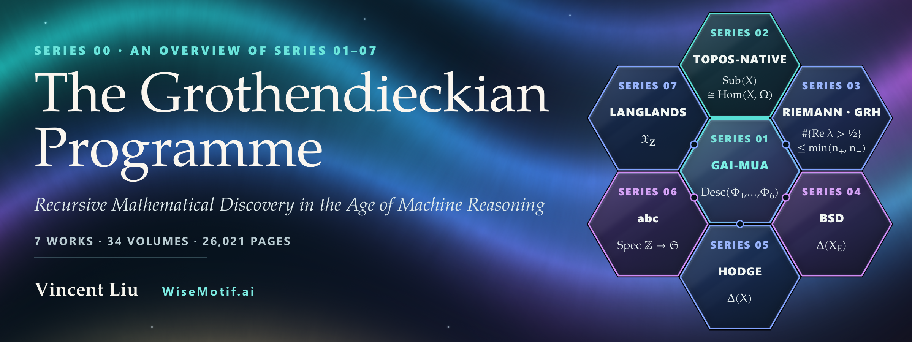
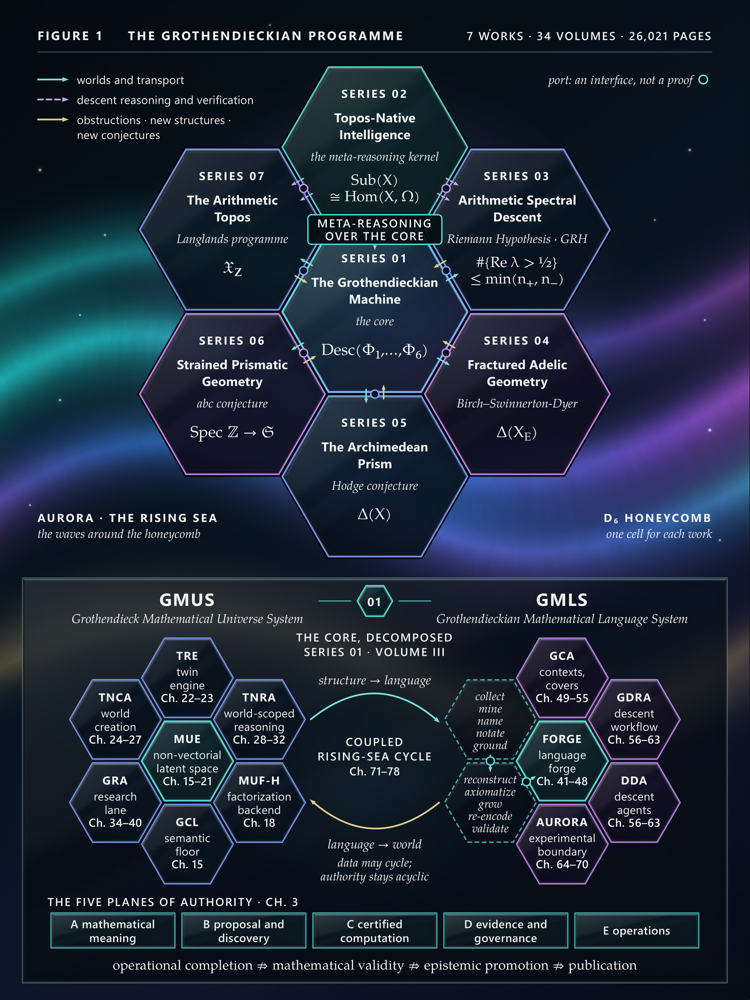
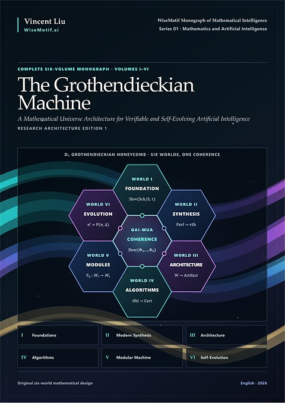
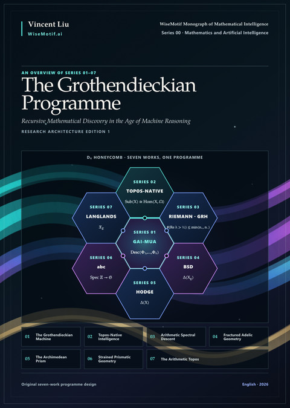

<p align="center">
  <a href="https://doi.org/10.5281/zenodo.23669107"></a>
</p>

<p align="center">
  <a href="https://doi.org/10.5281/zenodo.23669107"></a>
  <a href="https://creativecommons.org/licenses/by-nc-nd/4.0/"></a>
  <a href="https://github.com/AlienMuse/grothendieckian-programme/releases/tag/v1.0.0"></a>
  
  
  
  
  <a href="https://orcid.org/0009-0000-8718-222X"></a>
  <a href="VERIFY.md"></a>
</p>

<p align="center">
  <b><a href="https://github.com/AlienMuse/grothendieckian-programme/releases/download/v1.0.0/The-Grothendieckian-Programme-v1.0.0.pdf">Read the overview</a></b> (53 pages, 112.1 MB) ·
  <a href="#the-seven-works">The seven works</a> ·
  <a href="#three-papers-on-the-programme">Three papers</a> ·
  <a href="#the-architecture">Architecture</a> ·
  <a href="#the-programme-in-numbers">Numbers</a> ·
  <a href="https://alienmuse.github.io/grothendieckian-programme/">Website</a> ·
  <a href="#citation">Cite</a> ·
  <a href="README.zh-CN.md">中文</a>
</p>

<br>

> *To the memory of Alexander Grothendieck (1928–2014),<br>
> who did not force hard problems open,<br>
> but raised around them the universes in which they become natural,<br>
> until, as the sea rises, they open of themselves.*
>
> *This Programme asks whether that rising can be continued — and learned.*
> <br>— Dedication

**The Grothendieckian Programme** — *Recursive Mathematical Discovery in the Age of Machine Reasoning* — is a
programme for machine reasoning about mathematics, set out in seven works of the WiseMotif Monograph of Mathematical
Intelligence. This repository is its portal, and the book published here, Series 00, is their overview: it adds no
mathematical result to them.

**The question.** A system trained to predict the next token can answer a remarkable range of questions. The
Programme is concerned with a different capacity. Grothendieck's way with a hard problem was seldom to attack it
where it stood: he built the setting in which the problem became natural, and let the solution come to it. The
Programme asks whether a machine can take part in mathematics of that kind — whether it can construct a world in
which a problem becomes natural, test that world against everything already known, say precisely where it fails, and
pose the next question there — and what such a machine must be, internally, if anything it concludes is to be
trusted.

**The method.** The Programme calls its method recursive mathematical discovery. A structure is proposed; it is
tested against the cases in which the answer is known; what survives is abstracted into a new setting, and the
question is posed again there. What does not survive is not discarded. It becomes a conjecture, a gap or a
falsification test, with a statement, a status and a place in a ledger, and it is carried forward as part of the
result.

**The boundary. None of the seven works claims a proof of the problems it studies.** The Riemann Hypothesis, the
Birch and Swinnerton-Dyer conjecture, the Hodge conjecture and the abc conjecture remain open, and so does the
Langlands correspondence over number fields beyond the cases the literature has proved; each work says so in its
first pages, in a sentence of its own. What each offers is the state of the question after the method has been
applied without concession: what has been proved, what has been reduced to stated hypotheses, and where each route
stops.

<table>
  <tr>
    <td align="center"><b>7</b><br><sub>works</sub></td>
    <td align="center"><b>34</b><br><sub>volumes</sub></td>
    <td align="center"><b>26,021</b><br><sub>pages</sub></td>
    <td align="center"><b>995</b><br><sub>chapters</sub></td>
    <td align="center"><b>349,000+</b><br><sub>formulas</sub></td>
    <td align="center"><b>10,500+</b><br><sub>numbered<br>statements</sub></td>
    <td align="center"><b>714</b><br><sub>algorithms</sub></td>
    <td align="center"><b>1,434</b><br><sub>figures and<br>plates</sub></td>
  </tr>
</table>

<sub>Each count was taken by two independent methods from the sealed editions; where a work publishes its own count,
that count is used, and where the two methods differ the smaller is given as a lower bound (+). The numbers measure
extent, not achievement. Definitions and both counts: [STATISTICS.md](STATISTICS.md).</sub>

## The architecture

<p align="center">
  <a href="assets/programme-architecture.jpg"></a><br>
  <sub>Figure 1 of the book. One cell for each work; each cell carries the formula at the centre of that work's cover. A
  port on a shared edge marks an interface, not a proof.</sub>
</p>

Seven works carry the Programme, drawn as seven cells of one honeycomb. **At the centre** stands *The Grothendieckian
Machine* (Series 01), which sets out how mathematical worlds are constructed, compared and carried from one setting
to another, and how a machine may hold them as typed, versioned and verifiable objects. **Above it**, on a shared
edge, stands *Topos-Native Intelligence* (Series 02), which states what an intelligence must be, internally, if it is
to reason inside such worlds: reasoning native to a topos, in which a conclusion exists only where the local evidence
glues. **Around the two** stand five research subjects — the Riemann Hypothesis and its generalisation, the
conjecture of Birch and Swinnerton-Dyer, the Hodge conjecture, the abc conjecture and the Langlands programme — on
each of which the method is carried through in full, with every step recorded in a form that a mathematician can check
and a machine can execute.

The two meet at the site. A world of the first work presents its evidence as a site; the kernel of the second work
places a sheaf of local information over that site and computes what glues. A bridge of the first work becomes a
morphism of sites, and an obligation becomes an open cell of a contract, printed as open until it is discharged. What
returns from the periphery to the core is method rather than result: a scoped archive of negative results that a
search can consult before it proposes; the lesson that the measure of AI-assisted mathematics is theorems, and that an
exact account of where they are missing is part of the mathematics; a record of each failure at the place where it
occurred, so that the next recursion can begin from it.

## The seven works

| No. | Work | Place · problem | Central structure | Status of the central claim, in the work's terms | Vols | Pages |
|:--|:--|:--|:--|:--|--:|--:|
| 01 | [*GAI-MUA: The Grothendieckian Machine*](https://github.com/AlienMuse/grothendieckian-machine) | the core | worlds, bridges and obligations; GMUS and GMLS; five planes of authority | a normative research architecture, its contracts mainly D, R and O | 6 | 14,905 |
| 02 | [*GM-Omega-Infinity: Topos-Native Intelligence*](https://github.com/AlienMuse/topos-native-intelligence) | the meta-reasoning kernel | reasoning native to a topos: site, sheaf, global section; nine layers; Topos-MoE | several local specialisations proved; no global subsumption or replacement result | 5 | 4,020 |
| 03 | [*Arithmetic Spectral Descent*](https://github.com/AlienMuse/arithmetic-spectral-descent) | research subject 1 · RH and GRH | an index in place of a positivity: the Krein Index Theorem; 23 scoped no-go theorems | AHK-1–AHK-3 ⇒ RH proved [T]; no arithmetic system satisfying them constructed [O] | 4 | 1,549 |
| 04 | [*Fractured Adelic Geometry*](https://github.com/AlienMuse/fractured-adelic-geometry) | research subject 2 · BSD | one object with two descriptions: FAP spaces, the spectrum X<sub>E</sub>, the line Δ(X<sub>E</sub>) | rank and leading-coefficient formulas from Conjecture A and the axioms [CONDITIONAL] | 4 | 571 |
| 05 | [*The Archimedean Prism*](https://github.com/AlienMuse/the-archimedean-prism) | research subject 3 · Hodge | algebraicity as descent along the prism Δ(X); axioms AP1–AP12 | five formulations proved equivalent from ten unconditional axioms [NEW]; none of the five proved | 5 | 1,309 |
| 06 | [*Strained Prismatic Geometry*](https://github.com/AlienMuse/strained-prismatic-geometry) | research subject 4 · abc | a base for Spec ℤ: the substrate 𝔖, strain, the Θ-dilation | Theorem C unconditional [NEW]; Theorems A and B conditional on named obligations | 5 | 1,666 |
| 07 | [*The Arithmetic Topos*](https://github.com/AlienMuse/the-arithmetic-topos) | research subject 5 · Langlands | one base, one trace: the curve 𝔛<sub>ℤ</sub> and the Main Conjecture | no case of the Main Conjecture established unconditionally | 5 | 2,001 |
| | **The seven works** | | | | **34** | **26,021** |

<sub>Table 1 of the book. The status column restates each work's own account, with its own labels.</sub>

<table>
  <tr>
    <td width="96" valign="top" align="center"><a href="https://github.com/AlienMuse/grothendieckian-machine"></a></td>
    <td valign="top"><b>Series 01 · <a href="https://github.com/AlienMuse/grothendieckian-machine"><i>GAI-MUA: The Grothendieckian Machine</i></a></b><br>
      <sub><i>A Mathematical Universe Architecture for Verifiable and Self-Evolving Artificial Intelligence</i></sub><br>
      The core of the Programme: it sets out how mathematical worlds are constructed, compared and carried from one setting to another, and how a machine may hold them as typed, versioned and verifiable objects.<br>
      <sub>6 volumes · 14,905 pages · <a href="https://doi.org/10.5281/zenodo.23480696">doi:10.5281/zenodo.23480696</a></sub></td>
  </tr>
  <tr>
    <td width="96" valign="top" align="center"><a href="https://github.com/AlienMuse/topos-native-intelligence"></a></td>
    <td valign="top"><b>Series 02 · <a href="https://github.com/AlienMuse/topos-native-intelligence"><i>GM-Omega-Infinity: Topos-Native Intelligence</i></a></b><br>
      <sub><i>A Sheaf-Theoretic Architecture for Verifiable Machine Intelligence</i></sub><br>
      The meta-reasoning kernel: it states what an intelligence must be, internally, if it is to reason inside such worlds: reasoning native to a topos, in which a conclusion exists only where the local evidence glues.<br>
      <sub>5 volumes · 4,020 pages · <a href="https://doi.org/10.5281/zenodo.23538544">doi:10.5281/zenodo.23538544</a></sub></td>
  </tr>
  <tr>
    <td width="96" valign="top" align="center"><a href="https://github.com/AlienMuse/arithmetic-spectral-descent"></a></td>
    <td valign="top"><b>Series 03 · <a href="https://github.com/AlienMuse/arithmetic-spectral-descent"><i>Arithmetic Spectral Descent</i></a></b><br>
      <sub><i>Obstruction Theory, Hodge–Krein Realization, and a Falsifiable Architecture for the Riemann Hypothesis</i></sub><br>
      Research subject 1: the Riemann Hypothesis. The single substantive choice of the work is the replacement of a positivity condition by an index condition.<br>
      <sub>4 volumes · 1,549 pages · <a href="https://doi.org/10.5281/zenodo.23564898">doi:10.5281/zenodo.23564898</a></sub></td>
  </tr>
  <tr>
    <td width="96" valign="top" align="center"><a href="https://github.com/AlienMuse/fractured-adelic-geometry"></a></td>
    <td valign="top"><b>Series 04 · <a href="https://github.com/AlienMuse/fractured-adelic-geometry"><i>Fractured Adelic Geometry</i></a></b><br>
      <sub><i>A Foundational Framework for the Birch and Swinnerton-Dyer Conjecture</i></sub><br>
      Research subject 2: the conjecture of Birch and Swinnerton-Dyer. The governing idea is one object with two descriptions.<br>
      <sub>4 volumes · 571 pages · <a href="https://doi.org/10.5281/zenodo.23585887">doi:10.5281/zenodo.23585887</a></sub></td>
  </tr>
  <tr>
    <td width="96" valign="top" align="center"><a href="https://github.com/AlienMuse/the-archimedean-prism"></a></td>
    <td valign="top"><b>Series 05 · <a href="https://github.com/AlienMuse/the-archimedean-prism"><i>The Archimedean Prism</i></a></b><br>
      <sub><i>Tame Period Geometry and the Hodge Conjecture</i></sub><br>
      Research subject 3: the Hodge conjecture. Algebraicity is not a property that a cohomology class possesses; it is a descent datum that a class carries along a prism.<br>
      <sub>5 volumes · 1,309 pages · <a href="https://doi.org/10.5281/zenodo.23597954">doi:10.5281/zenodo.23597954</a></sub></td>
  </tr>
  <tr>
    <td width="96" valign="top" align="center"><a href="https://github.com/AlienMuse/strained-prismatic-geometry"></a></td>
    <td valign="top"><b>Series 06 · <a href="https://github.com/AlienMuse/strained-prismatic-geometry"><i>Strained Prismatic Geometry</i></a></b><br>
      <sub><i>Deformation over the Absolute Base and the abc Conjecture</i></sub><br>
      Research subject 4: the abc conjecture. Over ℤ there is no base; the work asks for a substrate over which Spec ℤ acquires a relative cotangent direction.<br>
      <sub>5 volumes · 1,666 pages · <a href="https://doi.org/10.5281/zenodo.23610034">doi:10.5281/zenodo.23610034</a></sub></td>
  </tr>
  <tr>
    <td width="96" valign="top" align="center"><a href="https://github.com/AlienMuse/the-arithmetic-topos"></a></td>
    <td valign="top"><b>Series 07 · <a href="https://github.com/AlienMuse/the-arithmetic-topos"><i>The Arithmetic Topos</i></a></b><br>
      <sub><i>Foundations of a Trace-Theoretic Approach to the Langlands Programme</i></sub><br>
      Research subject 5: the Langlands programme. The Langlands correspondence is not a bijection; it is the value, at π<sub>0</sub>, of a trace taken on a self-dual six-functor geometry over a single global base.<br>
      <sub>5 volumes · 2,001 pages · <a href="https://doi.org/10.5281/zenodo.23629681">doi:10.5281/zenodo.23629681</a></sub></td>
  </tr>
</table>

One page for each work, with its boundary in its own words, its abstract as published, its structure, its
status labels and its numbers: [docs/works](docs/works/). The status labels of all seven:
[docs/status-labels.md](docs/status-labels.md); terms in English and Chinese: [docs/glossary.md](docs/glossary.md).

## The Grothendieckian move in seven works

Each of the seven works makes one move that the rest of it elaborates. Read by columns, the table shows a single pattern. In the first
column the difficulty is always a missing structure rather than a missing estimate. In the second column the answer is
always a change of the object in which the problem is posed.

| No. | Where the problem stood | What is changed | What becomes natural | What it costs; what stays open |
|:--|:--|:--|:--|:--|
| 01 | the language of a problem suppresses the structure needed to state the right invariant or gluing law | the ambient world, by a typed operation whose gains and losses are recorded | scattered phenomena become functorial, local, representable or reconstructible | every enlargement loses something; the return to the original question has to be shown |
| 02 | a model's context carries no notion of covering, so the condition that evidence glue constrains nothing | the context becomes a site, the evidence a sheaf, a conclusion a global section | an incoherence becomes an obstruction with a location and a size | no experiment run; the local specialisations are not composed into one forward map |
| 03 | positivity proves too much and has margins, while RH, if true, holds with no room | a positivity condition is replaced by an index condition | negative index one, with no real zeros in (0, 1), leaves no zero off the line | the arithmetic realisation and Problem A2<sup>⋆</sup> remain open |
| 04 | two quantities computed by unrelated mechanisms, joined by bridges at one point and in one direction | one object with two descriptions: the line Δ(X<sub>E</sub>) and its two trivialisations | the rank becomes an index, the leading coefficient a determinant | Conjecture A is not easier than the conjecture; twelve conjectures and fourteen obstructions |
| 05 | a condition on one class must produce a subvariety, and a closed current is not a positive one | algebraicity becomes a descent datum carried along a prism | projectivity is consumed at one step and denominators are produced at one step | two obstructions live, O1 and O2; O2 is the gap |
| 06 | Spec ℤ is terminal and its cotangent complex is zero, so the function-field proof has nowhere to run | a base: the substrate 𝔖 gives Spec ℤ a relative cotangent direction | bad reduction becomes strain, and Riemann–Hurwitz is restored over the substrate | the global assembly rests on named obligations; PO-079 carries the arithmetic weight |
| 07 | over **Z** there is no base, no Frobenius and so no trace | the bijection is replaced by the value of a trace over one global base | reciprocity becomes a trace identity, functoriality the naturality of the trace | the base is specified, not built; four gaps of the first rank and a fifth |

<sub>Table 2 of the book. Each row restates the work's own diagnosis and proposal.</sub>

## The Programme in numbers

| | 01 | 02 | 03 | 04 | 05 | 06 | 07 | Seven works |
|---|---:|---:|---:|---:|---:|---:|---:|---:|
| volumes | 6 | 5 | 4 | 4 | 5 | 5 | 5 | **34** |
| pages | 14,905 | 4,020 | 1,549 | 571 | 1,309 | 1,666 | 2,001 | **26,021** |
| chapters | 603 | 102 | 60 | 56 | 72 | 62 | 40 | **995** |
| formulas | 110,000+ | 62,000+ | 41,379 | 15,300+ | 33,400+ | 35,300+ | 51,800+ | **349,000+** |
| of them, display formulas | 20,531 | 4,935 | 2,612 | 922+ | 1,948 | 3,060+ | 5,048 | **39,000+** |
| numbered statements | 2,580+ | 3,360+ | 1,129 | 458+ | 912 | 1,178 | 964 | **10,500+** |
| algorithms | 126 | 380 | 60 | 12 | 53 | 35 | 48 | **714** |
| figures and plates | 830 | 124 | 102 | 30 | 36 | 192 | 120 | **1,434** |
| numbered tables | 0 | 550 | 17 | 39 | 39 | 107 | 0 | per work |
| references | — | — | 340 | 364 | 206 | 242 | 280 | per work |

<sub>Formulas: display and inline mathematics; numbered statements: theorems, propositions, lemmas, corollaries,
definitions and conjectures; + a lower bound where the two methods differ. Tables and references are not summed: the
works count them differently (Series 01 and 02 have no unified bibliography; the tables of Series 07 carry no caption). Definitions,
both counts of every work and the footnotes: [STATISTICS.md](STATISTICS.md); machine-readable: [programme.json](programme.json).</sub>

## Reading routes

| Route | For | Through the seven works |
|:--|:--|:--|
| First reading | a reader new to the Programme | this book; the Series Note and Abstract of each work; Series 07, Chapter 1, "a complete account of the whole architecture"; Part 0 of Series 04 and of Series 05 |
| Mathematical | a mathematician | the Volume I prospectus and source-critical chapters of Series 01; Part III of Series 03, the function-field paradigm; Route A of Series 05; the arithmetician's route of Series 07, Chapters 1, 7, 16, 19, 33–36 and 40 |
| Machine reasoning | an AI researcher | the Integrated Preface, Volume III Chapters 1–13 and the first two parts of Volume IV of Series 01; Part I, then Parts V, VI and IX of Series 02 |
| Formal and computational | a formaliser or engineer | the formalisers' route of Series 01; Part X of Series 05; Part VIII of Series 06; Chapters 37–38 and Appendix G of Series 07 |
| Sceptical | a referee | Parts X and XIV of Series 02; Chapters 5 and 58 of Series 03; Chapter 55 of Series 04; Route G of Series 05; Chapter 40, Appendix F and Chapter 39 of Series 07 |

<sub>Table 4 of the book. The sceptical route is the one most of the works recommend. As a page:
[docs/reading-routes.md](docs/reading-routes.md).</sub>

## Three papers on the Programme

Three papers introduce the Programme in article form: an overview, twelve theses and fifty-seven open problems. They were published on Zenodo on 2026-10-28 under CC BY 4.0, each with its own DOI, and the theses and the problems cite the overview. Their repository, [AlienMuse/grothendieckian-problems](https://github.com/AlienMuse/grothendieckian-problems), holds the 57 problems as issues, with the papers' sources, data and figures.

| Paper | Pages | DOI | PDF |
|---|---:|---|---|
| **[The Grothendieckian Programme: An Overview](https://doi.org/10.5281/zenodo.23734421)** — *Seven Open Works on Mathematics and Machine Reasoning*<br><sub>Two of the works specify a reasoning architecture — a core that holds mathematical worlds as typed, versioned and verifiable objects, and a kernel that reasons inside such worlds by sites, sheaves and descent. This paper describes the architecture, the five research subjects, the method, the published corpus and the open process by which the works are to be reviewed and continued.</sub> | 10 | [10.5281/zenodo.23734421](https://doi.org/10.5281/zenodo.23734421) | [PDF](https://zenodo.org/records/23734422/files/The-Grothendieckian-Programme-An-Overview.pdf) |
| **[The Rising-Sea Theses](https://doi.org/10.5281/zenodo.23734423)** — *Twelve Theses on Mathematics and Machine Reasoning*<br><sub>Each thesis is stated in one sentence, argued, tied to the passages of the seven works on which it rests, related to existing work, and paired with an observation that would refute it. The theses concern the unit of mathematical knowledge for a reasoning system, the place of epistemic status, the latent space of mathematical reasoning, attention, failure, authority, and the method of discovery.</sub> | 26 | [10.5281/zenodo.23734423](https://doi.org/10.5281/zenodo.23734423) | [PDF](https://zenodo.org/records/23734424/files/The-Rising-Sea-Theses.pdf) |
| **[The 57 Grothendieckian Problems](https://doi.org/10.5281/zenodo.23734426)** — *Open Problems for Mathematics and Machine Reasoning from the Grothendieckian Programme*<br><sub>Thirty-five come from the two works on the architecture of a reasoning system and twenty-two from the five works that each take a named conjecture or programme as research subject; no problem is one of those conjectures. Each problem is stated in the words of its source, located by work, chapter and page, given the status the source assigns it, and paired with a criterion that decides when it is solved, a note on existing work and the date of a literature check. Each problem is an issue of [AlienMuse/grothendieckian-problems](https://github.com/AlienMuse/grothendieckian-problems) with the same number (issues 1–57).</sub> | 54 | [10.5281/zenodo.23734426](https://doi.org/10.5281/zenodo.23734426) | [PDF](https://zenodo.org/records/23734427/files/The-57-Grothendieckian-Problems.pdf) |

<sub>The sentences under each title are from its abstract. The concept DOI resolves to the latest version of each paper.</sub>

## The book

*The Grothendieckian Programme* is one book in three parts and eleven chapters, 53 pages with its covers, with five
figures and four tables. **Part I, The Idea** — the Programme in brief; beyond next-token prediction; recursive
mathematical discovery and the principles of the Programme. **Part II, The Architecture** — the architecture of the
Programme; the core: *The Grothendieckian Machine*; the kernel: *Topos-Native Intelligence*; five research subjects. **Part III, Synthesis, Discipline and Invitation** —
the Grothendieckian move in seven works; one discipline across seven works; what the Programme claims, and what it
does not; an invitation.

<p align="center">
  <a href="https://github.com/AlienMuse/grothendieckian-programme/releases/download/v1.0.0/The-Grothendieckian-Programme-v1.0.0.pdf"></a><br>
  <b>The Grothendieckian Programme</b> · 53 pages · 112.1 MB
</p>

## Download

| File | Pages | Size |
|---|---:|---:|
| [**The Grothendieckian Programme**](https://github.com/AlienMuse/grothendieckian-programme/releases/download/v1.0.0/The-Grothendieckian-Programme-v1.0.0.pdf) — the complete book with both covers | 53 | 112.1 MB |

The same file, with an identical checksum, is archived at Zenodo: [doi:10.5281/zenodo.23669108](https://doi.org/10.5281/zenodo.23669108). The
figures are rendered at 600 pixels to the inch under vector text, the covers are 600 ppi full-bleed, all fonts are
embedded, and the PDF is linearised for fast opening.

## Contributing

Every work of the Programme ends with a list of what it has not done, stated precisely enough to be taken up. The
second work names three kinds of contribution that would matter most, and they apply to every work of the Programme:

- **Refutation** — a counterexample to a theorem, the failure of a stated degeneration, or an experiment in which a
  module fails the gate it names; each would remove something, and each is welcome.
- **Completion** — the obligations printed as open are stated precisely enough to be taken up, and several are
  problems of independent interest.
- **Construction** — an implementation of a specified part, run against the tests the works fix in advance.

The sixth work adds the reason a sceptical reading is not a concession: a reader who finds a false obligation, a
circular dependency or a certified failure of a locked comparison has advanced the subject more than one who merely
finds the architecture suggestive. Errors in this book: an
[errata issue](https://github.com/AlienMuse/grothendieckian-programme/issues/new?template=errata.yml); errors in one of the seven works: its own repository.

## Citation

> Liu, V. (2026). *The Grothendieckian Programme — Recursive Mathematical Discovery in the Age of Machine Reasoning*
> (Research Architecture Edition 1, version 1.0.0). Zenodo. https://doi.org/10.5281/zenodo.23669107

```bibtex
@book{liu2026grothendieckianprogramme,
  author    = {Liu, Vincent},
  title     = {The {Grothendieckian} Programme --- Recursive Mathematical Discovery in the Age of Machine Reasoning},
  series    = {WiseMotif Monograph of Mathematical Intelligence, Series 00},
  edition   = {Research Architecture Edition 1},
  version   = {1.0.0},
  year      = {2026},
  publisher = {Zenodo},
  doi       = {10.5281/zenodo.23669107},
  url       = {https://doi.org/10.5281/zenodo.23669107}
}
```

GitHub's *Cite this repository* button uses [CITATION.cff](CITATION.cff), which also lists the seven works. The
concept DOI 10.5281/zenodo.23669107 always resolves to the latest version; cite the version DOI 10.5281/zenodo.23669108 to refer to these exact
files. Each of the seven works has its own DOI (Table 1).

## Authenticity

Every file of the release is listed in `SHA256SUMS`, signed with OpenPGP and timestamped twice (RFC 3161 and
OpenTimestamps on Bitcoin). The signing key is the same as for Series 01–07.

Signing key fingerprint: `DA1A 1AEF D8B2 C17C FF3F 1D1B 3905 0F50 7A4F EC17`

GitHub releases of this repository are immutable. Copies obtained elsewhere that do not match `SHA256SUMS` are not
authentic. Three levels of verification: [VERIFY.md](VERIFY.md).

## License and AI use

The book is licensed under [CC BY-NC-ND 4.0](LICENSE): you may share it unchanged, with attribution, for
non-commercial purposes. Translations and other uses require written permission. Details: [NOTICE.md](NOTICE.md) ·
Name use: [TRADEMARKS.md](TRADEMARKS.md).

**Text and data mining rights are reserved** under Article 4(3) of Directive (EU) 2019/790. Training or fine-tuning
machine-learning models on the work is not permitted without written permission. Individual readers may use AI
tools to read, search, explain or translate the work for their own study. Full policy:
[TDM-AND-AI-POLICY.md](TDM-AND-AI-POLICY.md).

## The name

The adjective *Grothendieckian* names a mathematical method used in the seven works: the passage from objects to
relations, relativity to a base, the replacement of an inadequate ambient category by a more expressive one,
local-to-global passage by descent, and reconstruction from shadows. It carries no attribution of design or
endorsement to Alexander Grothendieck, or to any other mathematician whose work the seven works cite, and no named
person or institution has reviewed, authorised, sponsored or endorsed this publication. The dedication of the book
expresses respect only.

---

<p align="center"><sub>
  <a href="https://wisemotif.ai">WiseMotif Monograph of Mathematical Intelligence</a> · Series 00 · Mathematics and Artificial Intelligence<br>
  Series 01: <a href="https://github.com/AlienMuse/grothendieckian-machine"><i>GAI-MUA: The Grothendieckian Machine</i></a> ·
  Series 02: <a href="https://github.com/AlienMuse/topos-native-intelligence"><i>GM-Omega-Infinity: Topos-Native Intelligence</i></a> ·
  Series 03: <a href="https://github.com/AlienMuse/arithmetic-spectral-descent"><i>Arithmetic Spectral Descent</i></a> ·
  Series 04: <a href="https://github.com/AlienMuse/fractured-adelic-geometry"><i>Fractured Adelic Geometry</i></a> ·
  Series 05: <a href="https://github.com/AlienMuse/the-archimedean-prism"><i>The Archimedean Prism</i></a> ·
  Series 06: <a href="https://github.com/AlienMuse/strained-prismatic-geometry"><i>Strained Prismatic Geometry</i></a> ·
  Series 07: <a href="https://github.com/AlienMuse/the-arithmetic-topos"><i>The Arithmetic Topos</i></a><br>
  © 2026 Vincent Liu · <a href="https://orcid.org/0009-0000-8718-222X">ORCID 0009-0000-8718-222X</a> · <a href="https://alienmuse.github.io">alienmuse.github.io</a>
</sub></p>
